# dsh-plugins · DSH 插件集合

<p align="center">
  
</p>

<p align="center">
  
  &nbsp;
  
</p>

<p align="center">
  <strong>DeepSeek Harness（DSH）插件集合 · 每个插件独立成包，按需安装</strong><br>
  <em>工作台 · 桌宠 · 费用统计 · 桌面端 · 梁神模式 · 皮肤中心 · SSH 运维</em>
</p>

<div align="center">

[是什么](#是什么) · [当前在用](#当前在用2026-10-19实测) · [功能插件](#功能插件) · [快速开始](#快速开始) · [常见问题](#常见问题) · [已知限制](#已知限制) · [贡献](#贡献) · [许可](#许可)

</div>

## 是什么

dsh-plugins 是一个可搜寻、可按需安装的 DeepSeek Harness（DSH）插件集合。仓库里的每个插件都保持自包含：有自己的 README、配置与许可说明，可以单独安装、单独使用，也可以组合成一个更完整的 DSH 工作台。

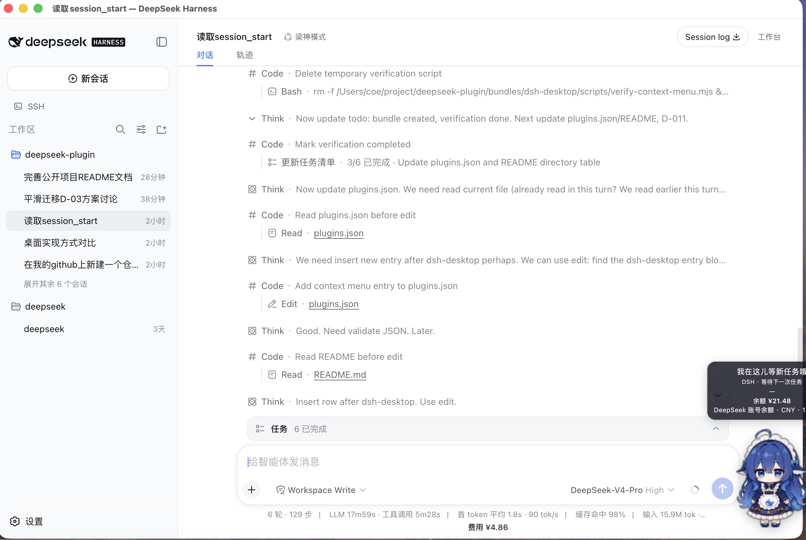

| 能力 | 原生 dsh web | 本仓库收录的插件 |
| --- | --- | --- |
| 右侧工作台 | 官方右栏（文件浏览 + 预览，只读） | ~~[dsh-workbench](#dsh-workbench)~~：**已废弃 2026-09-14**（0.1.5 起 rightbar 被官方独占，注册即抛异常）→ 改用外部 [dsh-better-sidebar](https://github.com/omdsh-dev/DSH-better-sidebar) |
| 桌面宠物 | 无 | [`dsh-pet-remielle`](https://github.com/Gin-7/dsh-pet-remielle)（外部，2026-10-19 选型落定，见[当前在用](#当前在用2026-10-19实测)）；[dsh-dafeiyu-mac](#dsh-dafeiyu-mac)：代码保留但当前不加载 |
| 费用统计 | 无 | ~~[dsh-deepseek-cost](#dsh-deepseek-cost)~~：**已废弃 2026-10-19**（只统计当前会话、定价为代码内快照）→ 改用外部 [`dsh-cost-meter`](https://github.com/Han-1413141/dsh-cost-meter) |
| 视觉理解 | 官方原生（V4.1-Flash 起） | ~~[dsh-vision-adapter](#dsh-vision-adapter)~~：**已废弃 2026-09-10**，官方模型已能原生收图 |
| 桌面端 | 官方（DSH Desktop `0.2.1-rc.2`） | ~~[dsh-desktop](#dsh-desktop--dsh-desktop-context-menu)~~：**已停止维护 2026-10-19**，整壳被官方 DSH Desktop 取代；原生右键菜单官方已内置 |
| Agent 预设 | 官方预设 | 梁神模式：面向 V4 Pro 的两阶段锚定预设（外部） |
| SSH 运维 | 无 | dsh-ssh：主机管理 / Web 终端 / SFTP / 隧道 / 集群（外部） |
| 主题皮肤 | 默认主题 | dsh-skins：皮肤中心 + 多款内置皮肤（外部） |
| 创意工坊 | 无 | `@linxin666/dsh-client-ui-market`：GUI 内浏览并安装 dsh-market.com 的皮肤 / 宠物 / 插件（外部） |
| 会话回放 | 无 | dsh-replay（外部，CLI）：离线解码完整轨迹 / diff / 统计 |
| 工作流视图 | 无 | dsh-plugin-agent-workflow（外部，仅 rc.8）：模型调用链路 |

## 当前在用（2026-10-19 实测）

> 本节是**权威索引**：数据取自本机 desktop profile（`~/.dsh/profiles/desktop`）的 `package.json` `dependencies` 与实际 `bundles` 顺序，2026-10-19 实测。机读索引见 [`plugins.json`](plugins.json)。

### 依赖清单（dependencies 11 项）

| 插件 | 版本 | 归属 | 用途 | 状态 |
| --- | --- | --- | --- | --- |
| `@linxin666/dsh-client-ui-market` | `^0.4.7` | 外部社区 | 创意工坊：GUI 内浏览 dsh-market.com 的皮肤 / 宠物 / 社区插件并直接安装 | 在用 |
| `@linxin666/dsh-client-ui-skin-center` | `^0.4.7` | 外部社区 | 皮肤中心：浏览皮肤、先试穿再应用（资产写入 `~/.dsh/skins`） | 在用 |
| `@linxin666/dsh-client-ui-web-ui-settings` | `^0.4.7` | 外部社区 | 设置页容器：皮肤中心 / 桌宠等插件的设置卡片挂载处 | 在用 |
| `@linxin666/dsh-liangshen` | `^0.4.7` | 外部社区 | 梁神模式：面向 V4 Pro 的两阶段锚定 agent 预设（Minimal 双工具锚定 → Code Mode / PTC） | 在用 |
| `@linxin666/dsh-ssh` | `^0.4.7` | 外部社区 | 远程运维：主机管理 / Web 终端 / SFTP / 隧道 / 集群 + `ssh_*` agent 工具 | 在用 |
| `dsh-better-sidebar` | `^0.28.0` | 外部社区 | 右侧工作台：文件编辑 / 预览 / 内嵌浏览器 / 真实终端 / Git | 在用（替代已废弃的 `dsh-workbench`） |
| `dsh-cost-meter` | `^1.9.9` | 外部社区 | 费用统计：本会话 / 当日 / 历史费用 + 价格目录 + Coding Plan 额度 | 在用（替代已废弃的 `dsh-deepseek-cost`）；**今日花费唯一口径** |
| `dsh-pet-remielle` | `^0.4.6` | 外部社区 | 浮窗桌宠「蕾米埃尔」：随会话状态切换动作与气泡 | 在用（2026-10-19 桌宠选型落定） |
| `dsh-dafeiyu-mac` | `link:bundles/` | 本仓库自维护 | macOS 桌面大肥鱼：会话状态驱动的桌面伴侣 | **代码保留，但当前不加载**（在 `dependencies`、不在 `bundles`），venv 未删 |
| `dsh-watcher` | `link:` 本地仓库 | 本地 link | 只读 agent 工作路径观察器：会话头部「眼睛」，把会话快照折叠成轮次 / 阶段 / 工具证据 | 在用 |
| `dsh-window-drag` | `link:` 本地仓库 | 本地 link | 桌面窗口顶部 12px 透明拖拽带（`hiddenInset` 无原生标题栏时的拖窗兜底），全屏自动隐藏 | 在用 |

版本列写的是 profile `package.json` 里的声明范围；`link:` 项无版本号，以本地仓库当前代码为准。

### 实际加载顺序（bundles 13 项）

加载与 patch 叠加顺序即 `bundles` 数组顺序，改动时请保持官方 base / web-app 在最前：

1. `@deepseek-ai/dsh-base` — 官方内置
2. `@deepseek-ai/dsh-web-app` — 官方内置
3. `@linxin666/dsh-liangshen`
4. `@linxin666/dsh-ssh`
5. `@linxin666/dsh-client-ui-skin-center`
6. `@linxin666/dsh-client-ui-web-ui-settings`
7. `dsh-watcher`
8. `dsh-better-sidebar`
9. `dsh-window-drag`
10. `@deepseek-ai/dsh-experimental-auto-review` — 官方内置
11. `dsh-cost-meter`
12. `@linxin666/dsh-client-ui-market`
13. `dsh-pet-remielle`

### 官方内置 bundle（不在 profile dependencies 内）

| bundle | 说明 |
| --- | --- |
| `@deepseek-ai/dsh-base` | 核心：Host / agent 运行时 / 基础 client UI。随官方 DSH Desktop `0.2.1-rc.2` 分发 |
| `@deepseek-ai/dsh-web-app` | Web 应用外壳（会话列表 / composer / 主题）。同上，版本跟 App 走 |
| `@deepseek-ai/dsh-experimental-auto-review` | 实验性的自动审阅 provider。同上，按需保留在 `bundles` 里 |

这三项由 App 内置提供，**不出现在** `~/.dsh/profiles/desktop/package.json` 的 `dependencies` 中，也不应手工 `pnpm add` 或单独升级——要换版本就换 App。

### 截图

图注里的「本机实拍」指在本机真实截取的界面；「上游官方预览图」指插件作者随 npm 包 / 仓库分发的示意图。两类不混用，逐张注明来源与许可。

**截屏可用性**：2026-10-19 早期 `screencapture -x` 返回 `could not create image from display`（宿主未授予屏幕录制权限），当日授权后恢复。此后新增的 `assets/plugins/@linxin666/**` 与 `assets/plugins/dsh-cost-meter/cost-overview-redacted.png` 均为**本机实拍**；此前入库的 2 张 cost-meter 图与 1 张 watcher 图仍为上游材料。

**打码规则（隐私）**：本仓库是公开仓库。实拍只截插件自身面板（设置页右侧内容区），**不截左侧会话列表与聊天正文**；面板内出现的金额、账号、主机名一律用**实心色块覆盖**（不使用可被还原的模糊）。已入库的三张实拍：创意工坊、皮肤中心设置卡、费用概览（金额已覆盖）。

**`@linxin666/dsh-client-ui-market`**

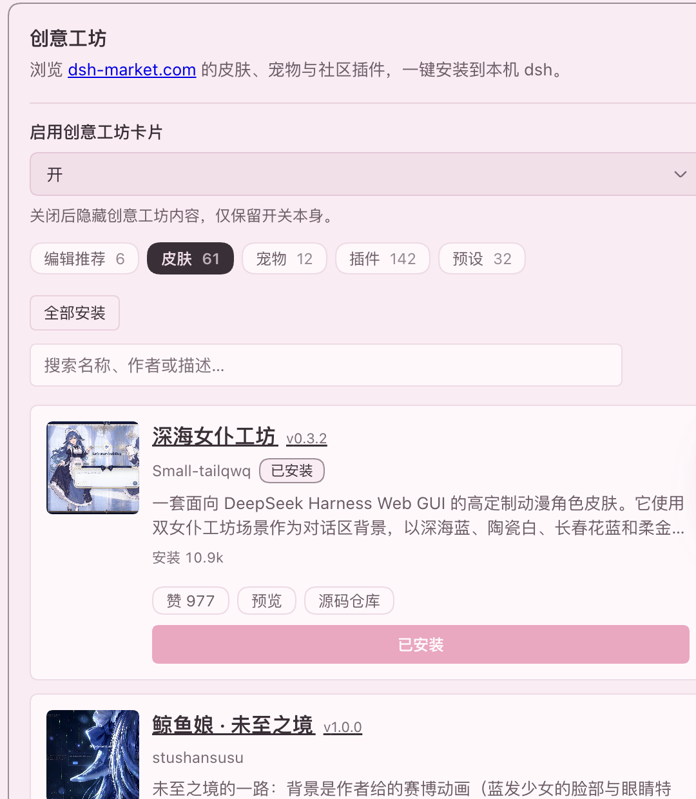

*来源：2026-10-19 本机实拍（设置 → 创意工坊）。画面为插件自身面板，不含会话或聊天内容。上游 npm 包 `0.4.7` 与 `zhu1090093659/dsh-web` 的 `packages/dsh-market` 均未附预览图，故此前标记「暂无」。*

**`@linxin666/dsh-client-ui-skin-center`**

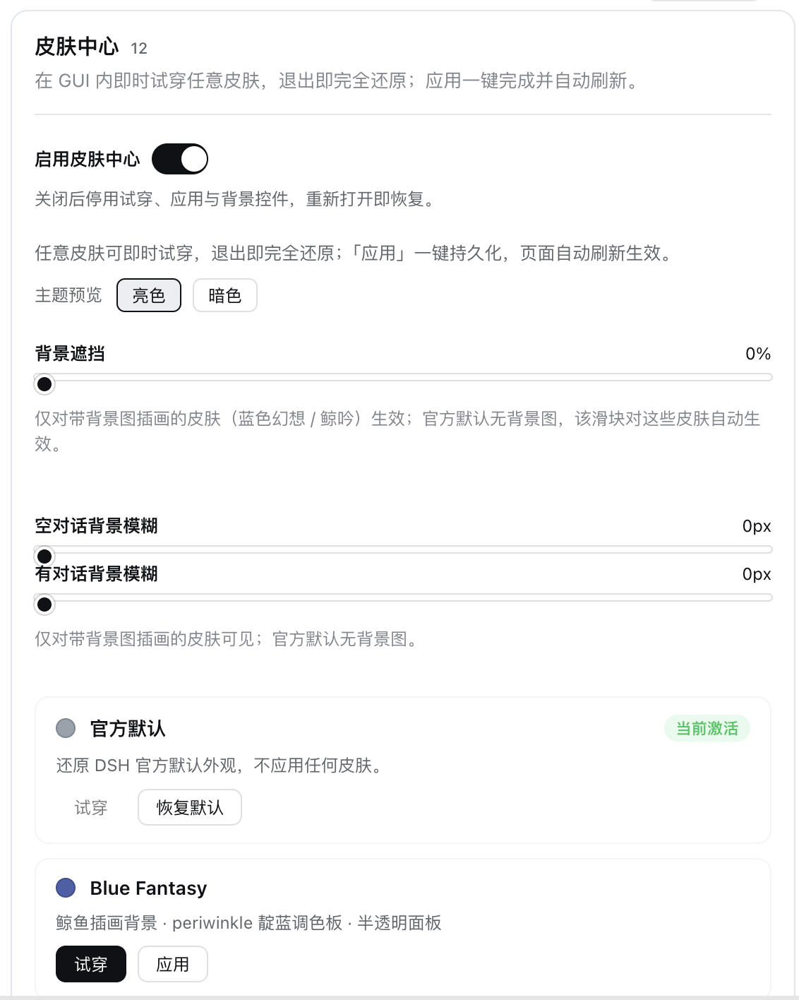

*来源：本仓库既有本机实拍 `docs/screenshots/skin-center.png`（2026-08-18，作者本机）。拍摄时皮肤中心尚未从 `@linxin666/dsh-skins` 拆成独立包。*

2026-10-19 重拍（现用 `@linxin666/dsh-client-ui-skin-center@0.4.7` 的设置卡）：

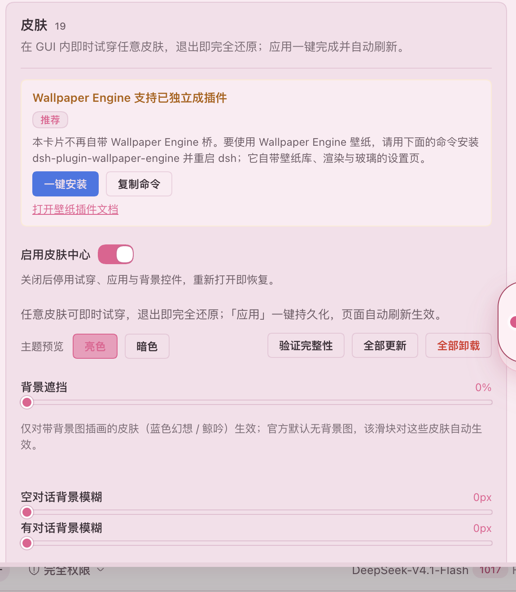

*来源：2026-10-19 本机实拍（设置 → 皮肤），只截设置页右侧内容区，画面内无会话内容。*

**`@linxin666/dsh-client-ui-web-ui-settings`** — 暂无预览图。它是官方「设置」页的挂载容器，上游 npm 包与 `dsh-web` 仓库均无该包专属截图；其效果即「设置页里多出的皮肤中心 / 桌宠设置卡片」。（同一批设置卡片的实拍见上方皮肤中心图与下方 `dsh-dafeiyu-mac` 设置卡片图。）

**`@linxin666/dsh-liangshen`**

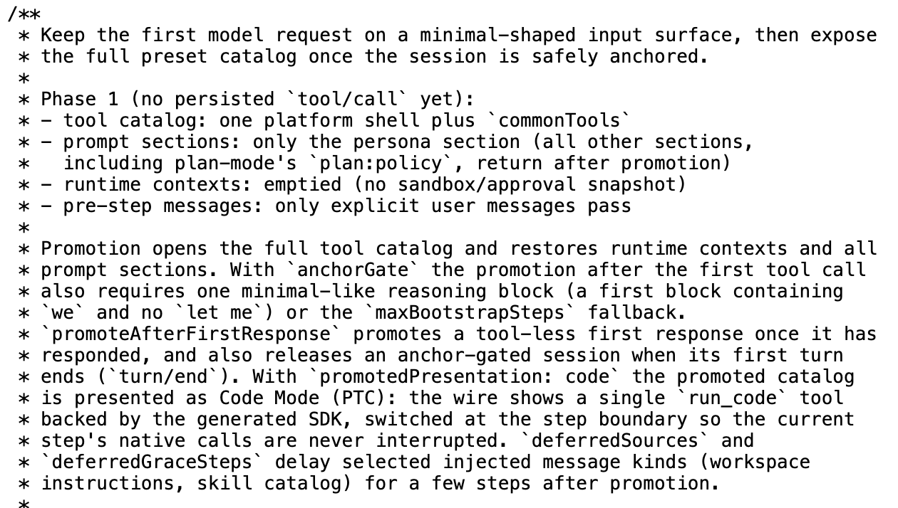

*来源：本仓库既有本机实拍 `docs/screenshots/liangshen-mode.png`（2026-08-18，作者本机）。*

**`@linxin666/dsh-ssh`**

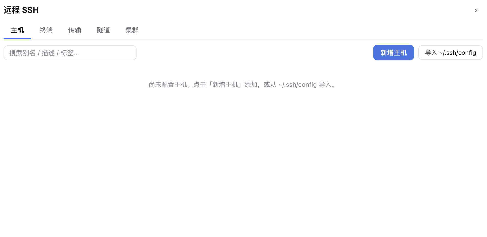

*来源：本仓库既有本机实拍 `docs/screenshots/ssh-panel.png`（2026-08-18，作者本机）。*

**`dsh-better-sidebar`**

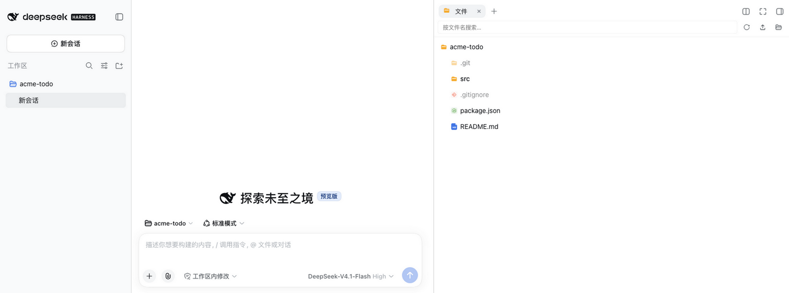

*来源：本仓库既有本机实拍（2026-09-14，隔离演示环境，示例工程 `acme-todo`），见 [D-027](DECISIONS.md) 回填。*

**`dsh-cost-meter`**

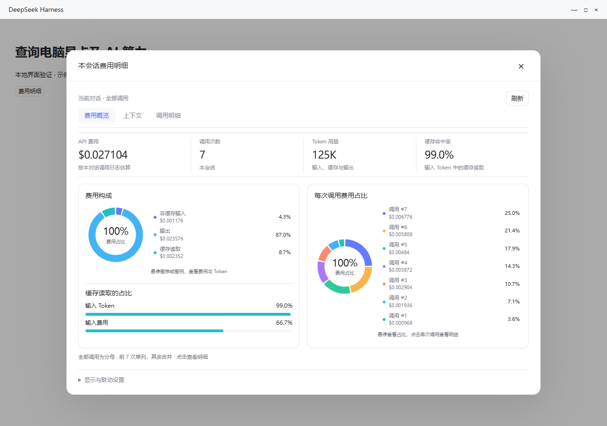

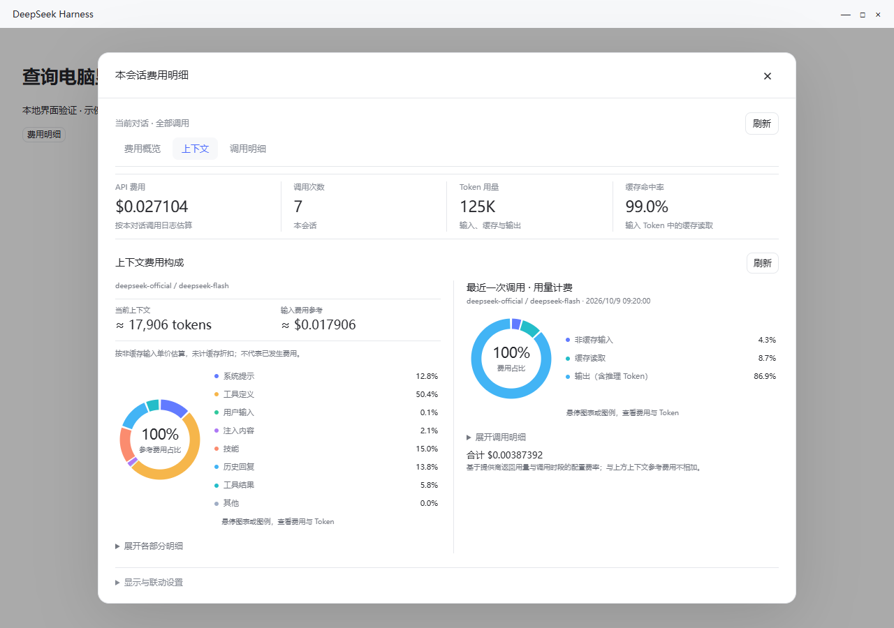

*来源：上游官方预览图，非本机实拍。取自 npm 包 `dsh-cost-meter@1.9.9` 自带文件 `docs/cost-share-overview.png`、`docs/context-costs-preview.png`；上游仓库 [Han-1413141/dsh-cost-meter](https://github.com/Han-1413141/dsh-cost-meter)，许可 MIT（图片版权归上游作者）。*

2026-10-19 本机实拍（概览页；三张汇总卡的金额已按打码规则覆盖）：

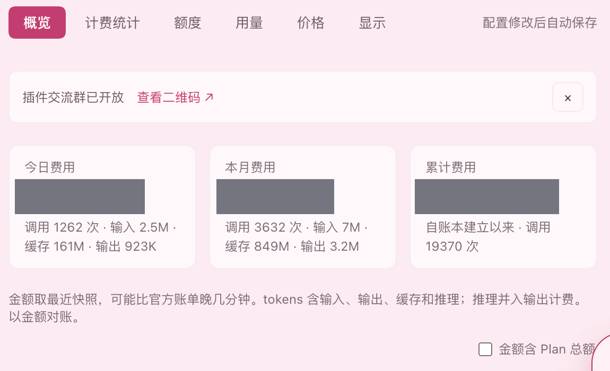

*来源：2026-10-19 本机实拍（设置 → 费用 → 概览）。金额被实心色块覆盖；调用次数与 token 统计保留。*

**`dsh-pet-remielle`** — 暂无预览图。本机截屏不可用；上游包确实自带角色图（`assets/pets/remielle/`），但角色形象版权归 HoYoverse（见包内 `NOTICE`），**不在本仓库转存再分发**，请直接看 [上游仓库预览](https://github.com/Gin-7/dsh-pet-remielle)。

**`dsh-dafeiyu-mac`**


*来源：本仓库既有本机实拍 `docs/screenshots/dafeiyu-pet.png`（2026-08-18，作者本机）。注意：该插件当前**不加载**，此图仅作代码保留期的存档参考。素材许可见 [`ASSET_LICENSE.md`](bundles/dsh-dafeiyu-mac/ASSET_LICENSE.md)（CC BY-SA 4.0）。*

**`dsh-watcher`**

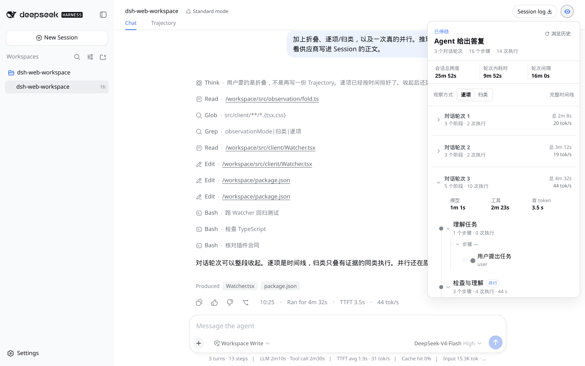

*来源：同作者自维护仓库 `dsh-watcher/docs/screenshots/overview.png`（MIT），原图拷贝入库；非本次新拍。*

**`dsh-window-drag`** — 暂无预览图。本地自维护仓库没有截图，效果又是一条 12px 的完全透明拖拽带，没有可见 UI 可拍；行为说明见 [dsh-window-drag README](https://github.com/Siq5005/dsh-window-drag)。

### 维护须知

**1）2026-10-19 的变动**

- **移除** `dsh-deepseek-cost`：`plugins.json` 中标 `deprecated`，替代品 `dsh-cost-meter@1.9.9`。
- **新增** `dsh-cost-meter`、`@linxin666/dsh-client-ui-market`、`dsh-pet-remielle`；随皮肤中心拆包同时补上 `@linxin666/dsh-client-ui-skin-center` 与 `@linxin666/dsh-client-ui-web-ui-settings`。
- **桌宠选型落定** `dsh-pet-remielle@0.4.6`，试用记录见下节。
- **`dsh-dafeiyu-mac` 保留代码但当前不加载**：它仍写在 `dependencies`（`link:bundles/`），但已从 `bundles` 移除，所以不会被加载；其 Python venv **没有删**，要恢复只需把 `dsh-dafeiyu-mac` 补回 `bundles`。

**2）花费口径统一在 `dsh-cost-meter` 账本**

今日花费的唯一口径 = `dsh-cost-meter` 账本里的 `days[today].costCny`：

```sh
node -e "const l=require(process.env.HOME+'/.dsh/storages/cost-meter/ledger.json');console.log(l.days[new Date().toISOString().slice(0,10)].costCny)"
```

`dsh-pet-remielle` 的桌面气泡按这个口径显示花费，为此打了一个**可重放补丁**，脚本在本机 `/Users/coe/project/deepseek/patches/remielle-ledger-basis.mjs`。

> ⚠️ **插件升级后必须重跑该脚本**——升级会用上游文件覆盖掉补丁点，不重跑就会出现「气泡花费与账本对不上」。选择与验证过程见 [D-030](DECISIONS.md)。

**3）desktop profile 的 `dsh plugin` CLI 被 App 独占**

desktop profile 由 Electron App 独占持有，`dsh plugin --profile desktop ...` 会直接报错。改插件只能走手工流程：

1. 编辑 `~/.dsh/profiles/desktop/package.json` 增删依赖；
2. 在该目录执行 `pnpm install`；
3. **手工把新插件补进 `bundles` 数组**——`pnpm install` 只装包、不写 `bundles`，漏了这一步表现就是「装好了但没反应」。

**4）网络：本机 `github.com:443` 直连不通**

推送与拉取要一次性走本地代理，不要写进全局配置：

```sh
git -c http.proxy=http://127.0.0.1:7897 push origin main
```

`raw.githubusercontent.com` 直连也常直接超时（`curl` 返回 `000`），下载上游素材时同样加一次性的 `-x http://127.0.0.1:7897`。

### 桌宠试用记录

2026-10-19 一天内试了三只宠物（外加原有 dafeiyu 的去留结论），结论如下（同代际 `0.2.1-rc.2`，三只均为真机试装）：

| 候选 | 版本 | 结论 | 原因与处置 |
| --- | --- | --- | --- |
| `@linxin666/dsh-pet` | `0.4.7` | 否掉 | 桌宠渲染在 Web UI 内、没有页面外置顶窗，切走浏览器标签就看不见宠物。已从 profile 移除，`plugins.json` 标 `deprecated` |
| `dsh-pet-live2d` | `3.3.2` | 试装后移除 | macOS 桌面窗这条路径上游作者**未真机验证**，装上去行为不确定；风险不可接受，撤 |
| `dsh-pet-remielle` | `0.4.6` | **采用** | 浮窗常驻、桌面上随时可见；花费口径用可重放补丁接到 `dsh-cost-meter` 账本（见「维护须知」2） |
| `dsh-dafeiyu-mac` | 本仓库 | 保留但不加载 | 代码与 venv 都留着，等 remielle 稳定一段时间再决定去留 |

结论沉淀在 [D-030](DECISIONS.md)：桌宠选 Remielle，花费口径统一到账本。


## 功能插件

### dsh-workbench（已废弃）

> **已废弃（2026-09-14）**：上游 DSH **0.1.5** 把右侧列由 `details` 改名为 `rightbar`，并把 `rightbar` 交给官方 `dsh-client-ui-sidebar-right` **独占**——该槽是 `kind:'single'`，slot 注册表对二次注册直接抛 `single slot "rightbar" already has a registration`，本插件注册即失败、面板无法显示，**不能靠改名修复**（正解是改用 `sidebar.right.pane.tab` + `dockkit` 的 `TabHookContext`，等于重写 UI 集成）。原因与证据见 [D-026](DECISIONS.md)。
>
> **请改用外部插件 [dsh-better-sidebar](https://github.com/omdsh-dev/DSH-better-sidebar)**——文件编辑 / 预览 / 内嵌浏览器 / 真实终端 / Git 全覆盖，`0.19.0` 起适配 DSH `0.1.5-rc.1+`，并已声明在 `0.1.5-rc.2` 上真机验证：
>
> ```sh
> dsh plugin --profile <name> add dsh-better-sidebar@latest
> ```
>
> 首次会因 pnpm 拦截 `node-pty` 构建脚本而失败（依赖已写入）；在 profile 的 `pnpm-workspace.yaml` 里把 `allowBuilds` 的 `node-pty` 设为 `true` 后重跑即可。

替换后的实际效果（本仓库在隔离演示环境中的实拍，示例工程 `acme-todo`）：

| 文件面板 | Git 面板 |
| --- | --- |
|  | 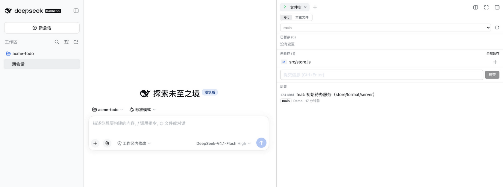 |

归档说明（仅适用于 **DSH ≤ 0.1.2-rc.1**，那条线上 `details` 无人占用、插件可正常工作）：VS Code 式右侧工作台，文件浏览 / 编辑 / 预览 + 内嵌浏览器 + Git 面板，入口在会话头部「工作台」按钮。代码保留归档，既有安装命令仍然有效：

```sh
dsh plugin --profile <name> add "Siq5005/dsh-plugins#path:/bundles/dsh-workbench"
```

详见 [dsh-workbench README](bundles/dsh-workbench/README.md)。

### dsh-dafeiyu-mac

macOS 桌面大肥鱼：由 DSH 真实会话状态驱动的桌宠伴侣。透明置顶窗口显示当前项目、阶段与待办进度，思考 / 工作 / 等待确认 / 出错等状态都有对应动作与文案；可选联动 dsh-deepseek-cost 显示 DeepSeek 账号余额。

| 桌宠状态气泡 | 设置卡片 |
| --- | --- |
|  | 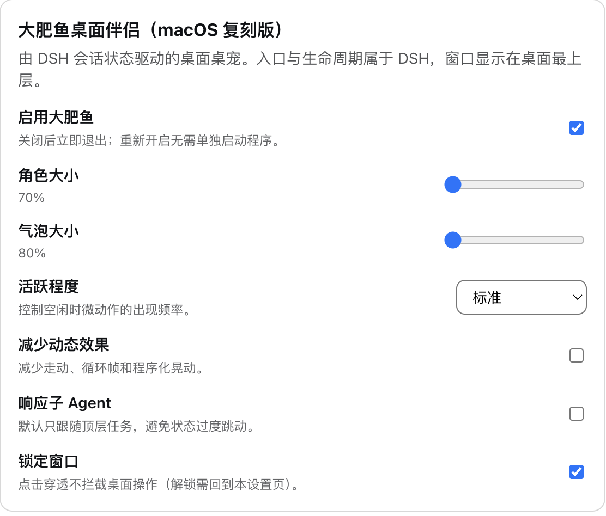 |

安装：

```sh
dsh plugin --profile <name> add "Siq5005/dsh-plugins#path:/bundles/dsh-dafeiyu-mac"
```

> macOS arm64 开箱即用；其他平台需要 Python 3.11+ 与 PySide6，或运行构建脚本生成 helper。详见 [dsh-dafeiyu-mac README](bundles/dsh-dafeiyu-mac/README.md)。

### dsh-deepseek-cost（已废弃）

> **已废弃（2026-10-19）**：官方 DSH Desktop `0.2.1-rc.2` 这一代生态里已有能力超集，本插件不再自维护。**请改用外部插件 [`dsh-cost-meter`](https://github.com/Han-1413141/dsh-cost-meter)**（`1.9.9`，459 stars、MIT、2026-10-19 仍在推送，`engines.dsh` 覆盖 `0.2.x`）：本会话成本 / 当日费用 / 历史记录 + 官方价格同步，内置 170+ 模型 ID 价格目录与自动匹配，并提供 13 家 Coding Plan 订阅额度查询。
>
> ```sh
> dsh plugin --profile <name> add dsh-cost-meter
> ```
>
> ⚠️ `dsh-cost-meter` 不提供 `dshDeepseekBalance` 服务，`dsh-dafeiyu-mac` 桌宠的余额气泡联动会因此断掉（要么改一行 inject 指向 `costMeter.getState`，要么接受缺口）。原因与证据见 [D-028](DECISIONS.md)。
>
> 归档说明：按 DeepSeek 官方定价统计当前对话的 token 用量与累计费用，在聊天输入框下方的统计行旁实时显示；支持高峰 / 空闲分时计价、按模型计价、会话投影持久化，并可查询当前 API Key 的账号余额。

| 费用展示 | 设置页 |
| --- | --- |
|  | 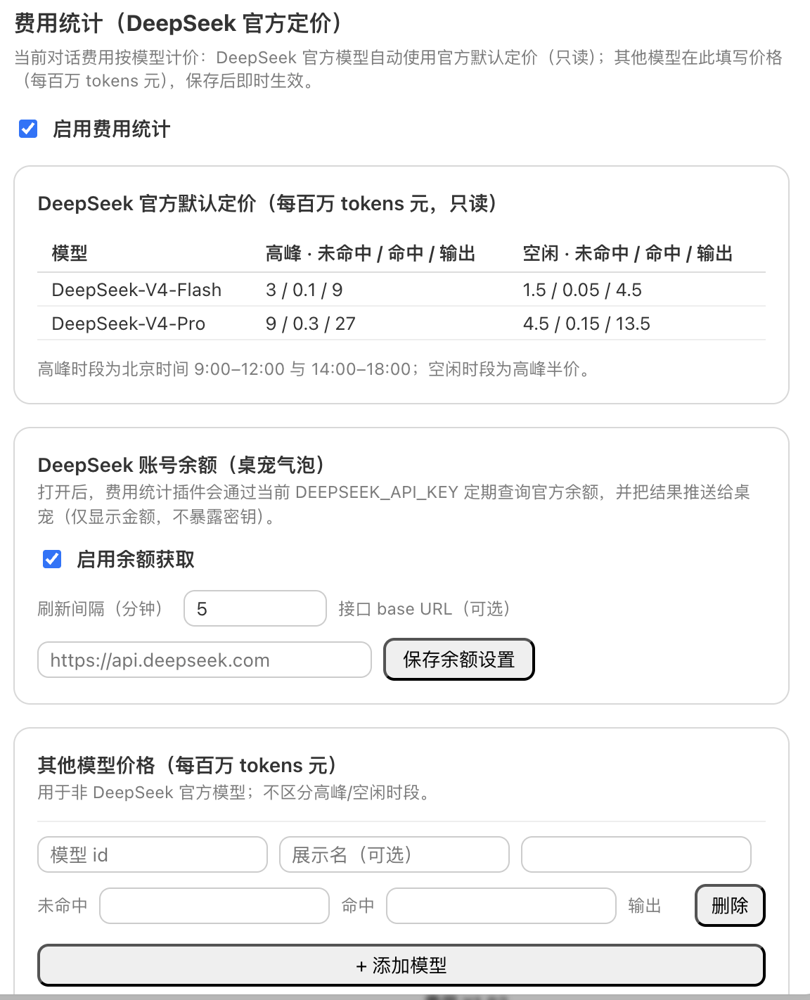 |

安装：

```sh
dsh plugin --profile <name> add "Siq5005/dsh-plugins#path:/bundles/dsh-deepseek-cost"
```

详见 [dsh-deepseek-cost README](bundles/dsh-deepseek-cost/README.md)。

### dsh-vision-adapter（已废弃）

> **已废弃（2026-09-10）**：官方 `deepseek-flash`（DeepSeek-V4.1-Flash）已原生支持图像理解。只要在主模型目录里声明 `inputModalities: [text, image]`（`settings.yaml` 的 `llm-deepseek.models`），harness 就会把图片作为真实 image content block 直接发给主模型，无需本插件的「图片→文本」改写，`analyze_image` 工具与 `deepseek-vision` 包装组也随之多余。**新环境请直接用原生路径**；本条目与代码保留归档，既有安装命令仍然有效。
>
> 反向提醒：若主模型**不在**目录里（例如被钉在已下线的旧模型名上的会话），harness 会把它判定为 text-only，图片被**静默**替换成 `[image omitted because this model accepts text only; ...]` 占位符——这正是本插件过去兜底的场景。遇上就在模型菜单里切到 `V4.1-Flash`。

给 DeepSeek 纯文本主模型加“眼睛”：图片在 adapter 层改写为文本，`analyze_image` 工具按需调用你配置的 OpenAI 兼容多模态端点，文字答案回到主模型继续推理。支持内容哈希缓存、失败语义明确的降级。

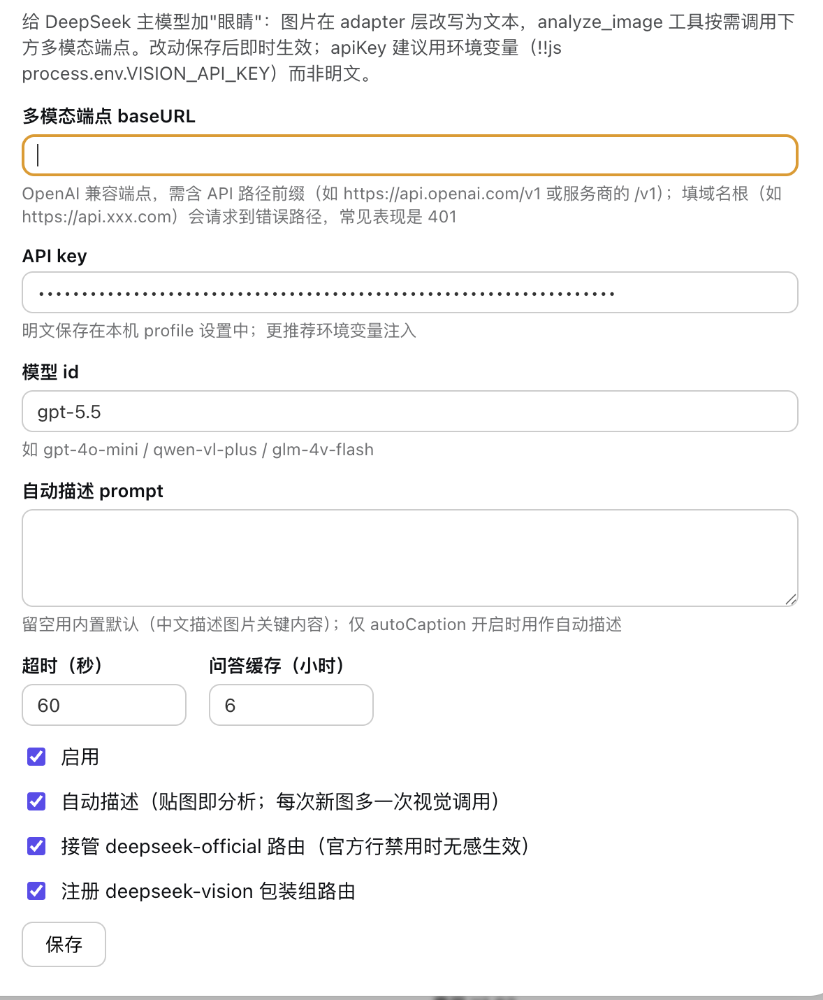

*（下图为废弃前的配置界面，仅作存档参考。）*

安装：

```sh
dsh plugin --profile <name> add "Siq5005/dsh-plugins#path:/bundles/dsh-vision-adapter"
```

> 多模态调用消耗你自己的第三方 API 额度。详见 [dsh-vision-adapter README](bundles/dsh-vision-adapter/README.md)。

### dsh-desktop & dsh-desktop-context-menu（已停止维护）

> **已停止维护（2026-10-19）**：整个壳已被**官方 DSH Desktop `0.2.1-rc.2`** 取代（`deepseek-ai/deepseek-harness` 的 `apps/desktop`，tag `dsh-v0.2.1-rc.2`）——原生窗口、托盘、多 profile 切换、原生右键菜单与打包分发均由官方提供。
>
> - **迁移去向**：[官方 DSH Desktop 0.2.1-rc.2 发布页](https://github.com/deepseek-ai/deepseek-harness/releases)。两者共用 `~/.dsh`，profile / 会话 / 凭据无需搬动。
> - [Siq5005/dsh-desktop](https://github.com/Siq5005/dsh-desktop)：README 顶部已加停止维护横幅；**未 archive**（可回填）。
> - `dsh-desktop-context-menu`：官方已内置窗口原生右键菜单（`apps/desktop/src/main.ts:278`，tag `dsh-v0.2.1-rc.2`），复制 / 粘贴 / 剪切 / 全选自带，仅少「后退 / 前进」。
>
> 归档说明（仅适用于旧的自建壳环境）：把 Electron 桌面壳做成 DSH bundle（desktop-as-plugin），提供托盘、多 profile 切换与 DMG 打包；右键菜单插件为窗口加原生菜单，Host-only，普通 Web profile 自动 no-op。原因与证据见 [D-028](DECISIONS.md)。

| 桌面客户端 | 原生右键菜单 |
| --- | --- |
| 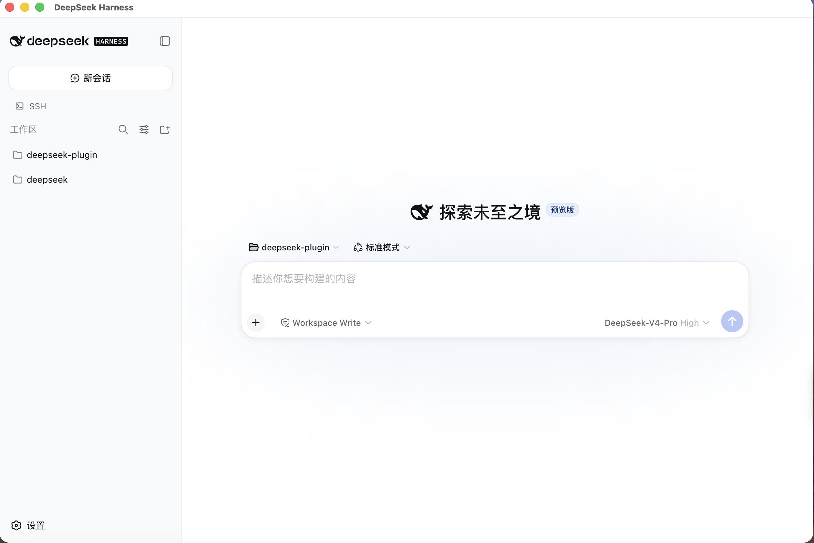 | 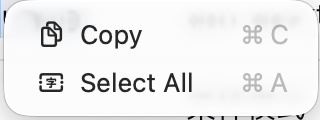 |

安装右键菜单：

```sh
dsh plugin --profile <name> add "Siq5005/dsh-plugins#path:/bundles/dsh-desktop-context-menu"
```

### 外部插件

以下插件由 [zhu1090093659/dsh-web-ui](https://github.com/zhu1090093659/dsh-web-ui) 等上游项目发布，本仓库仅收录索引，不托管代码。

| 插件 | 说明 | 截图 |
| --- | --- | --- |
| [`dsh-better-sidebar`](https://github.com/omdsh-dev/DSH-better-sidebar) | **右侧工作台（推荐）**：文件编辑 / 预览 / 内嵌浏览器 / 真实终端 / Git / 侧边对话；`0.19.0` 起适配 DSH `0.1.5-rc.1+` |  |
| [`dsh-cost-meter`](https://github.com/Han-1413141/dsh-cost-meter) | **费用统计（推荐，替代 dsh-deepseek-cost）**：本会话 / 当日 / 历史费用 + 官方价格同步，170+ 模型价格目录，13 家 Coding Plan 额度 | — |
| [`@linxin666/dsh-pet`](https://github.com/zhu1090093659/dsh-pet) | 多宠物伴侣：注册表驱动的浮动桌宠，逐只命名 + 抚摸 / 喂食 + 亲密度（渲染在 Web UI 内） | — |
| [`@linxin666/dsh-client-ui-market`](https://github.com/zhu1090093659/dsh-web) | 创意工坊：GUI 内浏览并安装 dsh-market.com 的皮肤 / 宠物 / 社区插件 | — |
| `@linxin666/dsh-liangshen` | 梁神模式：两阶段锚定 agent 预设 |  |
| `@linxin666/dsh-skins` | 皮肤中心 + 多款内置皮肤 |  |
| `@linxin666/dsh-ssh` | SSH 运维：主机管理 / Web 终端 / SFTP / 隧道 / 集群 |  |
| `dsh-plugin-agent-workflow` | 工作流视图：按轮次展示模型请求 / 响应 / 工具调用链路（**仅适配 rc.8**，0.1.2-rc.1 需先验证） | — |
| `dsh-replay` | 会话时间旅行调试器（CLI）：离线解码 `session.jsonl.zstd` → 时间线 / diff / 统计，零依赖 | — |

安装：

```sh
dsh plugin --profile <name> add dsh-better-sidebar@latest
dsh plugin --profile <name> add dsh-cost-meter
dsh plugin --profile <name> add @linxin666/dsh-pet
dsh plugin --profile <name> add @linxin666/dsh-client-ui-market
dsh plugin --profile <name> add @linxin666/dsh-liangshen
dsh plugin --profile <name> add @linxin666/dsh-skins
dsh plugin --profile <name> add @linxin666/dsh-ssh
dsh plugin --profile <name> add github:xuanyuanzhifeng/dsh-plugin-agent-workflow#v0.1.1 --workspace-root
npx dsh-replay <session-id> --out replay.html
```

> `dsh-better-sidebar` 首次安装会被 pnpm 拦下 `node-pty` 构建脚本（依赖已写入）；在 profile 的 `pnpm-workspace.yaml` 把 `allowBuilds` 的 `node-pty` 设为 `true` 后重跑即成功。

> `dsh-skins` 的皮肤中心通常还需安装 `@linxin666/dsh-client-ui-web-ui-settings`。

## 相关仓库状态

| 仓库 | 状态 | 说明 |
| --- | --- | --- |
| [`Siq5005/deepseek-harness`](https://github.com/Siq5005/deepseek-harness) | 已归档（archived） | 我方对社区版 Harness 的 fork；**官方版已取代此 fork，仅供历史参考**——主线 `deepseek-ai/deepseek-harness` 已发布 `0.2.1-rc.2`，本 fork 不再跟进 |
| [`Siq5005/dsh-desktop`](https://github.com/Siq5005/dsh-desktop) | 停止维护 2026-10-19 | 整个 Electron 壳被官方 DSH Desktop `0.2.1-rc.2` 取代（未 archive，可回填）；见 [D-028](DECISIONS.md) |
| [`Siq5005/dsh-plugins`](https://github.com/Siq5005/dsh-plugins) | 维护中 | 本仓库：插件索引 + 归档代码，功能保留 |

## 快速开始

### 环境要求

- 已安装 DeepSeek Harness，`dsh web` 可正常启动。
- Node.js 20+（各插件包均要求 Node 20+）。
- 仅 `dsh-dafeiyu-mac` 额外要求 macOS arm64 开箱即用；其他平台见其 README。

### 安装单个插件（推荐）

`dsh plugin add` 会转发给 pnpm，可从 git 仓库只安装目标子目录，无需克隆整个仓库：

```sh
dsh plugin --profile <name> add "Siq5005/dsh-plugins#path:/bundles/<plugin-name>"
```

例如安装费用统计：

```sh
dsh plugin --profile <name> add "Siq5005/dsh-plugins#path:/bundles/dsh-deepseek-cost"
```

### 从本仓库安装

```sh
git clone https://github.com/Siq5005/dsh-plugins.git
cd dsh-plugins
dsh plugin --profile <name> add ./bundles/<plugin-name>
```

### 验证与卸载

安装后重启 `dsh web`，对应入口或配置页出现即生效；也可以用 `dsh --profile <name> --dump-config` 确认插件配置层已挂载。

卸载：

```sh
dsh plugin --profile <name> remove <plugin-name>
```

## 常见问题

<details>
<summary><strong>装完重启了，为什么侧边栏 / 界面没有新入口？</strong></summary>

先确认插件装进了目标 profile（命令里的 `--profile <name>`），再用 `dsh --profile <name> --dump-config` 确认插件配置层已挂载。注意页面刷新不够，要重启 `dsh web` 进程。

</details>

<details>
<summary><strong>工作台为什么替换了内置的「工具调用详情」面板？</strong>（历史条目，dsh-workbench 已于 2026-09-14 废弃）</summary>

dsh-workbench 采用 VS Code 式右侧布局，占用 shell 的 details 布局列。这是右侧工作台与内置工具调用详情面板的取舍；需要工具调用详情时可关闭工作台或切换布局。**注**：上游 0.1.5 已移除内置 Detail 面板、把右侧列改为 `rightbar` 并由官方 `dsh-client-ui-sidebar-right` 独占，这个取舍随之消失，插件也因此在 0.1.5 上不再可用（见 D-026）。

</details>

<details>
<summary><strong>桌宠装了没反应？</strong></summary>

`dsh-dafeiyu-mac` 内置的 helper 是 darwin-arm64 单文件；在 Intel Mac 或其他平台需要 Python 3.11+ 与 PySide6，或运行 `bash scripts/build-helper.sh` 自行构建。详见其 README。

</details>

<details>
<summary><strong>视觉识别要额外装插件吗？图片会消耗哪里的额度？</strong></summary>

不需要额外装插件。官方 `deepseek-flash`（V4.1-Flash）已原生支持图像理解，只要在主模型目录里声明 `inputModalities: [text, image]`，图片就随主模型的正常请求计费，不涉及任何第三方端点。

已废弃的 `dsh-vision-adapter`（2026-09-10）另当别论：它会把图片字节发给你在配置里填写的第三方 OpenAI 兼容多模态端点，消耗的是该第三方服务的 API 额度。仍在使用它的环境请自行确认端点与隐私策略。

</details>

<details>
<summary><strong>费用统计和 DeepSeek 官方账单不完全一致？</strong></summary>

费用统计按内置的 DeepSeek 官方定价快照估算，供会话内参考；官方调价后需更新插件内的定价快照。账号余额查询默认关闭，需在设置页显式开启。

</details>

## 已知限制

- `dsh-workbench`（已废弃、归档；仅 DSH ≤ 0.1.2-rc.1）无文件 watcher，需手动刷新；Git 面板暂不支持 push / pull / fetch。
- `dsh-dafeiyu-mac` 内置 helper 仅 darwin-arm64；onefile 首启解压约 5–8 秒。
- `dsh-deepseek-cost`（已废弃 2026-10-19，改用 `dsh-cost-meter`）只统计当前会话；官方模型定价为代码快照，官方调价需更新代码。
- `dsh-vision-adapter`（已废弃，归档）的图片描述记忆与问答缓存为会话内内存缓存，重启清空。
- `dsh-desktop-context-menu` 仅在 DSH Desktop 的 Electron 主进程生效，普通 Web profile 自动 no-op。
- 外部 npm 插件（梁神模式 / 皮肤中心 / SSH）的维护与已知问题以 [dsh-web-ui](https://github.com/zhu1090093659/dsh-web-ui) 项目为准。

## 贡献

1. 在对应目录下创建插件，可参考 [`bundles/hello-plugin`](bundles/hello-plugin/)；
2. 本地验证安装与功能；
3. 更新 [`plugins.json`](plugins.json) 与上方插件目录；
4. 提交 Pull Request。

提交前请确认：

- 插件目录自包含，并附有 README；
- 索引字段与 [`plugins.schema.json`](plugins.schema.json) 一致；
- 引用了第三方代码或素材时，保留相应许可说明。

## 许可

本仓库整体采用 [MIT License](LICENSE)。各插件目录内另有说明的，以目录内说明为准。

- 插件代码：MIT（目录内另有声明的除外）。
- `dsh-dafeiyu-mac` 的视觉素材：采用 [CC BY-SA 4.0](https://creativecommons.org/licenses/by-sa/4.0/) 许可，详见 [`ASSET_LICENSE.md`](bundles/dsh-dafeiyu-mac/ASSET_LICENSE.md)。

索引中列出的外部 npm 插件由各自项目负责许可与维护。
